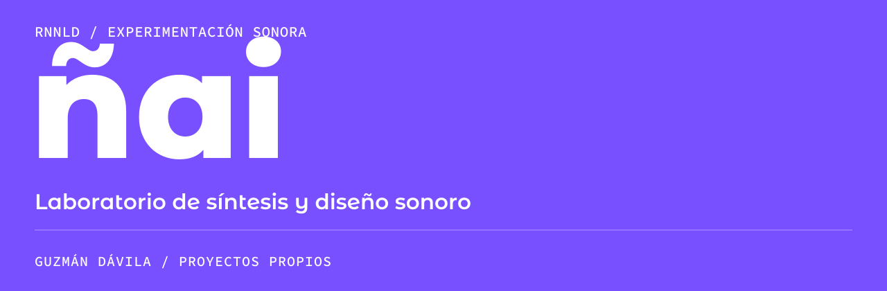

[← Perfil principal](https://github.com/guzmandavila) &nbsp; / &nbsp; [Portafolio ES](https://github.com/guzmandavila/portfolio/blob/main/PORTFOLIO_ES.md) &nbsp; / &nbsp; [Portfolio EN](https://github.com/guzmandavila/portfolio/blob/main/PORTFOLIO_EN.md)

### [Escuchar en SoundCloud ↗](https://soundcloud.com/rnnld)

**ñai** es mi proyecto de experimentación sonora: estudios de síntesis, diseño sonoro y pruebas de producción. Reúne trabajo de exploración de textura, estructura y entornos sonoros.

## Áreas de trabajo

**Síntesis** / Estudios y experimentos con sintetizadores de hardware.  
**Diseño sonoro** / Texturas, procesamiento y construcción de entornos sonoros.  
**Producción de audio** / Bocetos y pruebas de producción.

## Herramientas

Ableton Live · Pro Tools Studio · Sintetizadores de hardware · Procesamiento de audio

## Escucha y proyectos relacionados

El archivo de escucha está en [SoundCloud](https://soundcloud.com/rnnld). Las publicaciones del proyecto ambient y drone están en [Dronealt / Bandcamp](https://dronealt.bandcamp.com/music).

[Ver el repositorio de Dronealt →](https://github.com/guzmandavila/dronealt)

Investigación y experimentación en curso.

---

[Perfil principal](https://github.com/guzmandavila) &nbsp; / &nbsp; [Escríbeme ↗](https://wa.me/593979864314)
